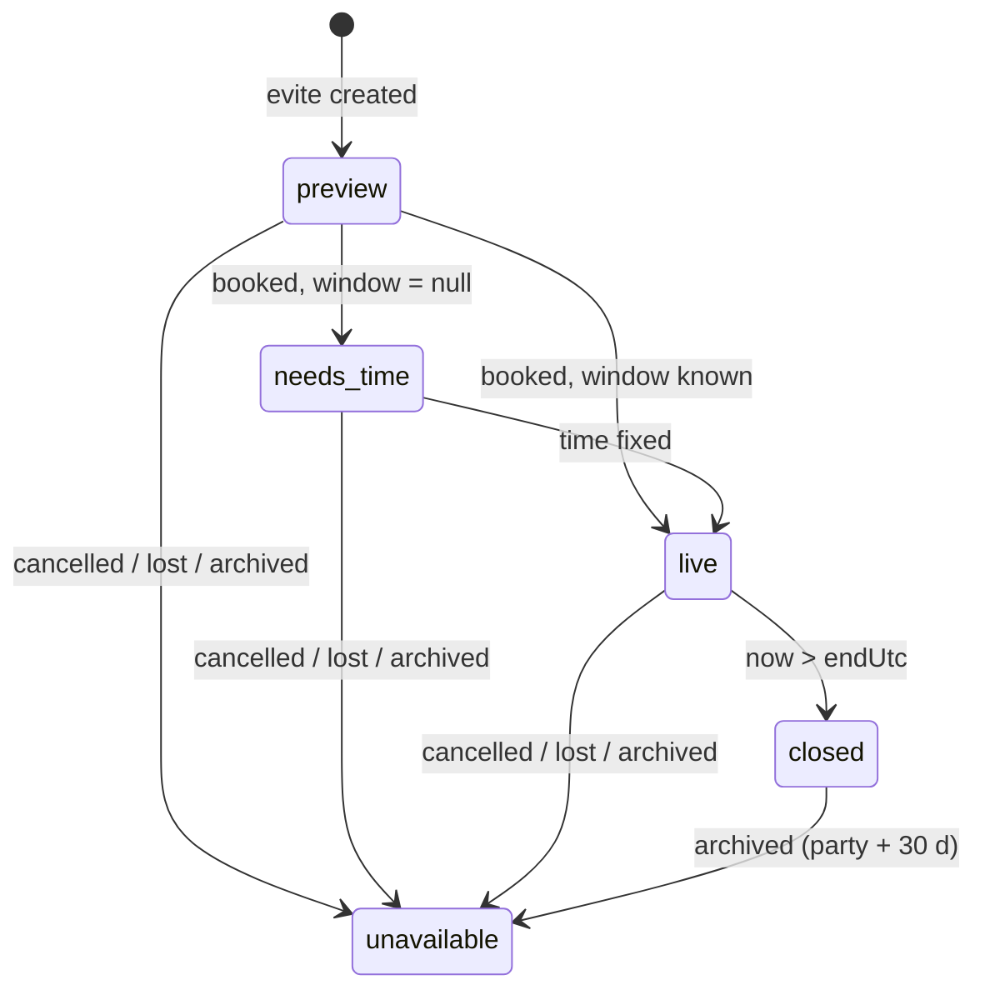

# Host Hampton EVITE — Architecture Spec (MVP)

**Status: LOCKED v1.2** (2026-10-10). v1.0 locked after adversarial review; v1.1 carries Adam's post-spike decisions. The changelog at the end lists every change and its resolution.
**Scope:** `02-SOW.md` · **Facts:** `01-codebase-review.md` · **Decisions:** `handoff/HANDOFF.md` §2 + review §6b.
Changes after lock need Adam's OK and a changelog entry.

All app paths are under `services/website/src/` unless stated.

---

## 0. Principles

1. **One home per fact.** Name, date, time, theme and address live on `bookings`. The evite stores only invitation-specific choices. Every displayed string is built by `inviteFacts()`.
2. **Derive state, don't flip it.** "Live" comes from `lib/bookingStatus.ts` at read time. No money writer is touched.
3. **Public means hostile.** `/i/*` is unauthenticated, unindexed and rate-limited. It returns only invite facts plus the caller's own RSVP. Unknown and unavailable answer identically.
4. **Claim before send; bound lateness; key by what the message says.** Every outbound email is claimed in `evite_sends` under a unique key that includes the calendar version it describes.
5. **Guests are not marketing contacts.** A guest is written to `contacts` only on Birthday Club opt-in. Even then, `contacts` consent flags are never changed: club consent lives on the RSVP row and the dedicated Brevo list.
6. **One layout, two renderers. No network at render time.** One React component renders for the browser and for Satori. Satori is called directly (not through `next/og`) with no asset loader, so it can never fetch anything.

---

## 1. Data model — `starting_plan/migration_068_evites.sql` (additive)

```sql
BEGIN;

CREATE TABLE evites (
  id                    uuid PRIMARY KEY DEFAULT gen_random_uuid(),
  booking_id            uuid NOT NULL UNIQUE REFERENCES bookings(id) ON DELETE CASCADE,  -- one evite per booking, ever
  slug                  text NOT NULL UNIQUE
                        CHECK (slug ~ '^[a-z0-9]+(-[a-z0-9]+)*-[0-9a-hjkmnp-tv-z]{4}$' AND char_length(slug) BETWEEN 9 AND 48),
  previous_slugs        text[] NOT NULL DEFAULT '{}',    -- re-minted before go-live; resolve → 308 to slug
  template_slug         text NOT NULL DEFAULT 'glow',
  theme_word            text CHECK (char_length(theme_word) BETWEEN 1 AND 12),
  theme_sub             text CHECK (char_length(theme_sub)  BETWEEN 1 AND 12),
  host_contact_name     text CHECK (char_length(host_contact_name) BETWEEN 1 AND 40),          -- NULL = studio default
  host_contact_phone    text CHECK (host_contact_phone ~ '^[2-9][0-9]{2}-[0-9]{3}-[0-9]{4}$'),  -- NULL = studio default
  show_host_contact     boolean NOT NULL DEFAULT true,
  host_note             text CHECK (char_length(host_note) <= 140),
  gift_note             text CHECK (char_length(gift_note) <= 140),
  rsvp_deadline         date,
  -- render bookkeeping
  render_version        integer NOT NULL DEFAULT 0,
  render_inputs_hash    text,
  image_key             text UNIQUE,                     -- 32 hex, random, independent of slug
  invite_object         text,                            -- e.g. invite-v3-9f2c.jpg (random suffix per attempt)
  og_object             text,
  rendered_at           timestamptz,
  render_claim          uuid,                            -- claim token
  render_claimed_at     timestamptz,
  render_error          text,
  -- calendar bookkeeping (independent of rendering)
  cal_version           integer NOT NULL DEFAULT 0,      -- ICS SEQUENCE; bumps only after go-live
  cal_inputs_hash       text,
  cal_changed_at        timestamptz,
  -- lifecycle
  went_live_at          timestamptz,                     -- stamped by cron when first seen live; never cleared
  cancelled_notice_at   timestamptz,
  archived_at           timestamptz,
  created_at            timestamptz NOT NULL DEFAULT now(),
  updated_at            timestamptz NOT NULL DEFAULT now()
);

CREATE TABLE evite_consent_texts (
  version     text PRIMARY KEY,
  channel     text NOT NULL CHECK (channel IN ('email')),
  wording     text NOT NULL,
  created_at  timestamptz NOT NULL DEFAULT now()
);
INSERT INTO evite_consent_texts VALUES ('club-v1','email','Send me party & craft ideas from Host Hampton', now());

CREATE TABLE evite_rsvps (
  id                   uuid PRIMARY KEY DEFAULT gen_random_uuid(),
  evite_id             uuid NOT NULL REFERENCES evites(id) ON DELETE CASCADE,
  status               text NOT NULL CHECK (status IN ('yes','no')),
  revision             integer NOT NULL DEFAULT 1,       -- +1 on every material change
  parent_name          text NOT NULL CHECK (char_length(parent_name) BETWEEN 1 AND 120),
  children             jsonb NOT NULL DEFAULT '[]'       -- [{"first_name": "Ava"}], siblings included
                       CHECK (jsonb_typeof(children) = 'array' AND jsonb_array_length(children) <= 6),
  child_count          integer GENERATED ALWAYS AS (jsonb_array_length(children)) STORED,
  adult_count          smallint NOT NULL DEFAULT 0 CHECK (adult_count BETWEEN 0 AND 2),   -- 2 = "2+"
  has_allergy          boolean,
  allergy_note         text CHECK (char_length(allergy_note) <= 300),
  note_to_honoree      text CHECK (char_length(note_to_honoree) <= 500),
  reminder_email       text CHECK (char_length(reminder_email) <= 254),
  reminder_phone_e164  text CHECK (reminder_phone_e164 ~ '^\+1[2-9][0-9]{9}$'),
  reminder_opt_out_at  timestamptz,
  cal_version_seen     integer NOT NULL DEFAULT 0,       -- highest cal_version this guest was sent
  club_email           text CHECK (char_length(club_email) <= 254),
  club_opt_in_at       timestamptz,
  opt_in_text_version  text REFERENCES evite_consent_texts(version),
  club_opted_out_at    timestamptz,
  birthday_month       smallint CHECK (birthday_month BETWEEN 1 AND 12),
  contact_id           uuid REFERENCES contacts(id) ON DELETE SET NULL,
  consent_ip           inet,
  edit_nonce           text NOT NULL CHECK (char_length(edit_nonce) = 16),   -- in the signed edit token; change to revoke
  allergy_purged_at    timestamptz,
  contacts_purged_at   timestamptz,
  created_at           timestamptz NOT NULL DEFAULT now(),
  updated_at           timestamptz NOT NULL DEFAULT now(),
  CONSTRAINT rsvp_no_has_no_party CHECK (status = 'yes' OR (jsonb_array_length(children) = 0 AND adult_count = 0)),
  CONSTRAINT rsvp_yes_has_a_child CHECK (status = 'no'  OR jsonb_array_length(children) >= 1),
  CONSTRAINT rsvp_club_is_complete CHECK (club_opt_in_at IS NULL OR (club_email IS NOT NULL AND opt_in_text_version IS NOT NULL)),
  CONSTRAINT rsvp_one_reminder_channel CHECK (reminder_email IS NULL OR reminder_phone_e164 IS NULL)
);
CREATE INDEX idx_evite_rsvps_evite ON evite_rsvps (evite_id);
CREATE INDEX idx_evite_rsvps_reminder_email ON evite_rsvps (lower(reminder_email), created_at) WHERE reminder_email IS NOT NULL;

-- DB-backed per-recipient cap (the in-memory limiter forgets after an hour and on deploy)
CREATE FUNCTION evite_reminder_email_recent(p_email text) RETURNS integer
  LANGUAGE sql STABLE SECURITY INVOKER AS
$$ SELECT count(*)::int FROM evite_rsvps
   WHERE lower(reminder_email) = lower(btrim(p_email)) AND created_at > now() - interval '24 hours' $$;

CREATE TABLE evite_sends (
  id           uuid PRIMARY KEY DEFAULT gen_random_uuid(),
  evite_id     uuid NOT NULL REFERENCES evites(id) ON DELETE CASCADE,
  rsvp_id      uuid REFERENCES evite_rsvps(id) ON DELETE CASCADE,
  send_type    text NOT NULL CHECK (send_type IN ('lead_preview','invite_ready','new_rsvp','rsvp_changed','rsvp_confirmed',
                                                  'week_before','day_before','details_changed','final_headcount','party_cancelled')),
  ref_version  integer NOT NULL DEFAULT 0,
  channel      text NOT NULL CHECK (channel IN ('email','sms')),
  status       text NOT NULL DEFAULT 'sending' CHECK (status IN ('sending','sent','failed','skipped')),
  attempts     integer NOT NULL DEFAULT 1,
  outcome      text,
  provider_id  text,
  last_error   text,
  claimed_at   timestamptz NOT NULL DEFAULT now(),
  sent_at      timestamptz
);
CREATE UNIQUE INDEX uniq_evite_send_once
  ON evite_sends (evite_id, rsvp_id, send_type, ref_version, channel) NULLS NOT DISTINCT;

CREATE TABLE evite_events (               -- analytics; no PII
  id          bigserial PRIMARY KEY,
  evite_id    uuid NOT NULL REFERENCES evites(id) ON DELETE CASCADE,
  event       text NOT NULL CHECK (event IN ('invite_viewed','share_clicked','rsvp_started','rsvp_completed',
                                             'club_opted_in','birthday_month_saved','calendar_added')),
  occurred_at timestamptz NOT NULL DEFAULT now()
);
CREATE INDEX idx_evite_events ON evite_events (evite_id, event);

CREATE FUNCTION touch_evites_updated_at() RETURNS trigger LANGUAGE plpgsql AS
$$ BEGIN NEW.updated_at := now(); RETURN NEW; END $$;
CREATE TRIGGER evites_updated_at      BEFORE UPDATE ON evites      FOR EACH ROW EXECUTE FUNCTION touch_evites_updated_at();
CREATE TRIGGER evite_rsvps_updated_at BEFORE UPDATE ON evite_rsvps FOR EACH ROW EXECUTE FUNCTION touch_evites_updated_at();

ALTER TABLE evites              ENABLE ROW LEVEL SECURITY;
ALTER TABLE evite_rsvps         ENABLE ROW LEVEL SECURITY;
ALTER TABLE evite_sends         ENABLE ROW LEVEL SECURITY;
ALTER TABLE evite_events        ENABLE ROW LEVEL SECURITY;
ALTER TABLE evite_consent_texts ENABLE ROW LEVEL SECURITY;
REVOKE ALL ON FUNCTION evite_reminder_email_recent(text) FROM anon, authenticated;
-- No policies: service role only.

COMMIT;
ALTER TYPE lead_source ADD VALUE IF NOT EXISTS 'evite';
```

**Storage:** a new public bucket `evites` (2 MB limit, `image/jpeg` only, no list policy).
- Objects: `evites/<image_key>/<invite_object>` and `<og_object>`.
- Each object name carries the render version **and a random 4-hex suffix per attempt**, so a half-failed attempt can never block its retry.
- Uploaded with `cacheControl '31536000'` and `upsert: false`.

**Rollback:** drop the five tables and the two functions. The enum value stays (harmless).

---

## 2. Module map

| Module | Responsibility |
|---|---|
| `lib/evites/config.ts` | Two flags. `evitePagesMode()` from `EVITES_PAGES` and `eviteSendsMode()` from `EVITES_SENDS`, each `off\|pilot\|on` (unrecognised = `off`). `isPilotBooking(ref)` reads `EVITES_PILOT_REFS`. Switching sends off never takes pages down mid-party. |
| `lib/evites/eligibility.ts` | `isEviteEligible(booking)`. Eligible if `party_type ∈ {in_studio_theme, mobile_party}`, or if `party_type` is NULL/`unknown` and `party_tags.location_type ∈ {host_hampton, mobile}`. Never `studio_rental`, `cancelled` or `lost`. |
| `lib/evites/slug.ts` | `makeSlug(firstName, themeShort)` produces e.g. `mia-glow-7kq2`. Suffix: 4 chars from `0123456789abcdefghjkmnpqrstvwxyz` via `crypto.randomInt`. Name part: NFKD, ASCII, first token, `[a-z0-9]`, ≤ 12 chars, else `party`. `slugNamePart(slug)` reads it back. |
| `lib/evites/ensure.ts` | `ensureEviteForBooking(supabase, bookingId)` returns `created \| exists \| ineligible \| disabled \| unavailable`. Inserts. On 23505 for `slug`, retries up to 5 times. On 23505 for `booking_id`, returns `exists`. **An archived evite still exists**, so it is never re-created. Never throws. |
| `lib/evites/themes.ts` | `resolveTheme(booking, lineItems)`. Order: theme line-item `pricing_item_id` → `party_themes.pricing_item_id`, then a normalised name match over `package_type`, `quote_snapshot.themeName` and `party_tags.theme/party_theme`. `glow-party` → template `glow`. Everything else → template `plain` (Glow art with no icon strip, theme word from the name, else `BIRTHDAY`). |
| `lib/evites/partyWindow.ts` | `partyWindow(booking)` returns `{startUtc, endUtc} \| null`. Start is `parseTime(party_time)` on `party_date` via `etToUtc`, **accepted only between 08:00 and 21:00 ET** (stops "2:00" parsing as 2 AM). Duration in minutes: mobile 60 (Entry) / 90 (Signature, and the default for mobile), mini party 90, theme party 120. Returns null when date or time won't parse. |
| `lib/evites/facts.ts` | `inviteFacts(booking, evite, lineItems, state)` returns `InviteFacts` (§3). Pure. Takes `state` so the preview reads "Pick your date". |
| `lib/evites/state.ts` | `inviteState(booking, payments, evite, now)` (§4). Pure. |
| `lib/evites/hash.ts` | `renderInputsHash(facts)` and `calInputsHash(facts)` (start, end, `calendarLocation`, title). |
| `lib/evites/glyphs.ts` | `fitsFont(text, fontKey)` and `screenForImage(text, fontKey)`. Replaces any character a bundled font lacks (checked against its cmap via `opentype.js`) with the nearest ASCII or drops it. Every image-bound string passes through it. |
| `lib/evites/fit.ts` | `fitFontSize(...)` from `opentype.js` advance widths (the `.woff` files; opentype.js reads WOFF, not WOFF2). Memoised. |
| `lib/evites/templates/{glow,plain}.ts` + `templates.schema.test.ts` | Template registry (§6). |
| `components/evites/InviteCanvas.tsx` | One component, `mode: 'web' \| 'satori'`. |
| `lib/evites/render.ts` | `renderEvite(supabase, eviteId, {force?})` (§5). |
| `lib/evites/ics.ts` | `buildIcs(facts, evite, url, {method: 'PUBLISH' \| 'CANCEL'})` and `googleCalendarUrl(...)` (§8). |
| `lib/evites/mail.ts` | `sendEviteEmail(...)`: the one Resend call for evites. Reads `{data, error}` and returns a named outcome. |
| `lib/evites/sends.ts` | `claimSend(key)`: INSERT; 23505 means skip. `reclaimFailed()`: UPDATE `failed` where attempts < 4, or `sending` older than 15 min, to `sending`. `finishSend(id, outcome)`. |
| `lib/evites/suppression.ts` | `emailSuppressed(supabase, email)` returns `suppressed \| clear \| unavailable` (§9.2). |
| `lib/evites/rsvpToken.ts` | Signed, stateless edit token (§7.5). |
| `lib/evites/screens.ts` | RSVP and host input screens. Names, notes, email via `isPlausibleEmailAddress`, phone, and **its own** 0..N count screen (`screenPublicCount` refuses 0). |
| `lib/evites/club.ts` | `recordClubOptIn(...)` / `recordClubOptOut(...)` (§10). |
| `lib/evites/analytics.ts` | `recordEviteEvent(...)` and `sendMetaViewContent(req)` (§11). |
| `lib/evites/views.ts` | Column allow-lists: `EVITE_BOOKING_COLUMNS`, `PUBLIC_RSVP_SELF_COLUMNS`, `HOST_RSVP_COLUMNS`, `ADMIN_RSVP_COLUMNS`. |
| `lib/email-templates/evites.ts` | All evite email bodies. `escapeFields` first, URLs through `mailHref`. Registered in `emailTemplateEscaping.test.ts`. |
| `lib/rateLimit.ts` (edit) | Add `guardRateHeaders(headers: Headers, rule)` for server components, sharing buckets with `guardRate`. Add `DAY_MS`. |

### 2.1 Integration call sites for `ensureEviteForBooking` (all non-fatal)

Every call sits **after** the booking write and after `recordInboundEvent` (`lib/plan.ts:16-26` ordering). Every call follows the `IntakeRecord` rule: an evite failure never changes the intake's HTTP answer.

| Site | Booking it has |
|---|---|
| `app/api/lead/route.ts` (after `ensureLeadPlan`) | lead |
| `app/api/quote/save/route.ts` | lead / quoted |
| `app/api/mobile-party-inquiry/route.ts` | lead |
| `app/api/party-builder/save/route.ts` (both branches) | awaiting_deposit |
| `app/api/party-checkout/route.ts` | pending_review |
| `app/api/admin/parties/create/route.ts`, `app/api/admin/bookings/route.ts` | awaiting / confirmed |
| `evite-sends` cron backfill | anything eligible with `party_date >= today` or created in the last 14 days |

- On `created`, the caller fires `queueRender(eviteId)`, a fire-and-forget call that adds the render to the process queue and returns at once (§5).
- **Two small intake fixes travel with this** because the invite needs them:
  - `quote/save` passes `childName` to `child_name`.
  - The `/api/lead` and `/api/mobile-party-inquiry` forms get an optional "Birthday child's first name" field.

---

## 3. `InviteFacts`

```ts
interface InviteFacts {
  hasName: boolean
  honoreeDisplay: string          // 'MIA' | 'BIRTHDAY STAR' (+ star icon image slot when !hasName → "BIRTHDAY STAR ⭐"; v1.1)
  ageOrdinal: string | null
  themeWord: string; themeSub: string; templateSlug: 'glow' | 'plain'
  dateLine: string                // state preview → 'Pick your date'; needs_time → 'Saturday, November 14';
                                  // else 'Saturday, November 14 · 2–4 PM'
  shortDateLine: string           // 'Sat, Nov 14 · 2–4 PM' | 'Pick your date'
  window: { startUtc: Date; endUtc: Date } | null
  locationType: 'studio' | 'mobile'
  placeLine: string               // page/portrait: studio full line | mobile full address | 'Location to be confirmed'
  cardPlaceLine: string           // OG: 'Host Hampton, Speonk' | mobile TOWN | 'Location to be confirmed'
  calendarLocation: string | null
  hostContactLine: string | null  // 'Any questions? Ask Allie · 631-998-9325'
  hostNote: string | null; giftNote: string | null; rsvpDeadline: string | null
  guestCap: number | null         // bookings.guest_count_approx
  title: string; description: string; shareText: string; reshareText: string
}
```

- **Name:** `child_name`, else `quote_snapshot.childName`. First token, ≤ 20 chars. No name → `honoreeDisplay = 'BIRTHDAY STAR'` plus the star icon **image** (`assets/glow/icons/star.png`) — v1.1, Adam 2026-10-10, because plain "BIRTHDAY" sat redundantly above "7TH Birthday!". The name slot auto-shrinks to fit it. The no-name OG title is "GLOW BIRTHDAY PARTY" (`<THEME> BIRTHDAY PARTY`). **No emoji in image text, ever** — the ⭐ is always the icon image, never a glyph.
- **Mobile town:** the locality before the state or ZIP. Unparseable → "Long Island". Provisional addresses (`isProvisionalAddress`) count as missing.
- **Studio:** `lib/studioLocation.ts` constants.
- **Host contact:** defaults to "Allie" and `STUDIO_PHONE_DISPLAY`, normalised to `631-998-9325`. Never `lib/paymentContacts.ts`.
- **Time:** `etDateString` / `etToUtc` / `Intl.DateTimeFormat(..., {timeZone:'America/New_York'})` only.
- Every string bound into the image passes `screenForImage()` for its slot font.

---

## 4. State machine



The state is evaluated in this order:

| State | Condition | Page | RSVP | Cal | Share |
|---|---|---|---|---|---|
| `disabled` | pages flag `off`, or `pilot` and the booking is not a pilot booking | unavailable | — | 404 | — |
| `unavailable` | `archived_at`, or `status ∈ {cancelled, lost}` | unavailable (same as unknown slug) | — | 404 | — |
| `closed` | booked, window known, `now > endUtc` | invite + "This party has happened 🎉" | — | 404 | — |
| `live` | booked (`bookingStage ∈ {booked, completed}`), window known | invite + RSVP | ✓ until `startUtc` | ✓ | ✓ once the render is fresh |
| `needs_time` | booked, window null | invite, "Time coming soon" | ✗ | 404 | ✗ |
| `preview` | otherwise | invite + "Preview" ribbon, "RSVPs open once the party is booked" | ✗ | 404 | ✗ |

- **"Booked" comes only from `bookingStage()`** in `lib/bookingStatus.ts`, fed by `sumPayments()` (tripwire E3). That covers Payment Element deposits, plan pay links, admin-recorded Venmo/Zelle/cash, and admin `confirmed` bookings.
- **Refunds (Q7), stated as they really work:**
  - A Stripe refund writes a negative ledger row and **does not touch `booking_payments`** (`lib/stripeAftermath.ts`, by design). Legacy statuses (`deposit_paid`, `confirmed`, `paid_in_full`) count as booked regardless of money.
  - So **a refunded party goes offline when it is cancelled** (`status = cancelled`), which is what a refunded deposit means in practice.
  - An admin-recorded refund row bringing net paid to ≤ 0, on a non-legacy status, also leaves the booked stage. The invite then falls back to `preview`, never to a fake "unavailable".
  - Tests pin all these cases.
- **A failed payments read** throws to `app/i/[slug]/error.tsx` (HTTP 500, "Something went wrong — try again in a moment"). It is never mis-stated as preview.
- **`went_live_at`** is stamped by the cron the first time an evite is seen `live`, using a conditional UPDATE. It gates re-slugging (§7.4) and the cancellation notice. It is never cleared.

---

## 5. Render pipeline

**Engine:** `satori` (new dependency) → SVG → **`sharp`** (already a dependency; librsvg rasterises Satori's path-based SVG) → JPEG.
- `next/og` is **not used**: its bundled `@vercel/og` always wires a loader that fetches `fonts.googleapis.com` and jsdelivr for missing glyphs.
- Satori is called with `fonts` from disk, `embedFont: true`, and **no `loadAdditionalAsset`**.
- If librsvg's output differs visibly from the mock in the Phase 0 spike, swap to `@resvg/resvg-js` (it has a musl build). That is a decision for the spike, not this spec.

**Triggers:**
1. `queueRender` after `ensure` returns `created`.
2. The cron finds evites whose `renderInputsHash(currentFacts) ≠ render_inputs_hash`, **2 per tick**.
3. The host PATCH, after a customisation.
4. Admin "Re-render".

There are no renders triggered by page or API GETs.

**Queue:** `globalThis.__eviteRenderQueue` holds a promise chain, concurrency 1, at most 20 waiting (beyond that, drop; the cron catches up).

**`renderEvite` steps:**
1. Load booking (`EVITE_BOOKING_COLUMNS`), line items, payments, evite. Compute `state` and `facts`. `hash = renderInputsHash(facts)`. If it equals `render_inputs_hash` and objects exist, return `fresh` (unless `force`).
2. **Claim:** `UPDATE evites SET render_claim = $token, render_claimed_at = now() WHERE id = $1 AND (render_claim IS NULL OR render_claimed_at < now() - interval '2 minutes') RETURNING id`. No row → `busy`.
3. Fit sizes. Build `<InviteCanvas mode="satori">` at 1085×1530, using the 1× background JPEG (not the 2170-wide PNG) to bound memory.
4. Portrait: `satori` → SVG → `sharp(svg).flatten({background:'#1b0630'}).jpeg({quality: 86, mozjpeg: true})`.
5. OG card: `satori` at 1200×630, with the portrait downscaled to 397×560 and embedded as a data URI → `sharp(...).flatten().jpeg({quality: 82, mozjpeg: true})`. **Assert < 300,000 bytes**, else fail with `render_error = 'og-too-large'`. The card is never stored over the limit.
6. `n = render_version + 1`, `sfx = randomHex(2)`. Upload `invite-v<n>-<sfx>.jpg` and `og-v<n>-<sfx>.jpg` under `image_key` (generated on first render).
7. `UPDATE evites SET render_version = n, render_inputs_hash = hash, invite_object = …, og_object = …, rendered_at = now(), render_claim = NULL, render_error = NULL WHERE id = $1 AND render_claim = $token`. **No row means another worker took over.** Leave its result alone; the orphaned objects are harmless. Read `{error}` on every write.
8. On any failure: `UPDATE … SET render_claim = NULL, render_error = $reason WHERE render_claim = $token`. The previous objects keep being served.

**Measured in the spike:** wall time and event-loop block per render. Above 500 ms, move the satori call into a `worker_threads` worker (same module, same queue) before Phase 2.
**P01 result (v1.1):** in `node:20-alpine` on the box (`--network none`, `-m 512m`, librsvg 2.58.93, sharp 0.33.5): ~2.8 s wall per portrait+OG pair, of which Satori is 20–150 ms and the rest is librsvg on the libuv pool; **max event-loop block 33 ms**; peak RSS 250 MB; OG ~75–80 KB; network 0; output byte-identical to Windows. The 500 ms trigger is not hit, so no worker is needed. `@resvg/resvg-js` was equal in quality but blocks the loop 0.8–1.5 s, so it is rejected.

**Fonts:** commit `public/evites/fonts/*.woff` (from `@fontsource`, latin subset) **with their OFL licence files**. They are used by both Satori and the page's `@font-face`. WOFF2 is never handed to Satori or opentype.js.

**Assets** (optimised from the handoff; `source-svg/` is never committed): `public/evites/glow/background.webp` (page), `background.jpg` (1085×1530, Satori), `icon-strip.png`, `squiggle.png`, `star.png`.

**OG metadata** points at the stored object: `…/storage/v1/object/public/evites/<image_key>/<og_object>`, with width 1200, height 630 and type `image/jpeg`. With no render yet it falls back to the static `/images/og-default.png`.

---

## 6. Template layout schema

Generalised from `handoff/templates/glow.layout.json` for the 11 themes coming in Phase 2.

```ts
interface TemplateLayout {
  slug: string
  canvas: { width: 1085; height: 1530 }
  background: { web: string; raster: string }
  layers: Array<
    | { id: string; type: 'shape'; left: number; top: number; width: number; height: number; radius: string;
        fill?: string; border?: { width: number; color: string; sides: ('t'|'r'|'b'|'l')[] }; glow?: Glow }
    | { id: string; type: 'image'; src: string; left: number; top: number; height: number; rotateDeg?: number }>
  slots: Slot[]
  ogCard: { portraitHeight: 560; radius: 14; titleFont: FontKey; titleSize: 74; titleColor: string; glow: Glow;
            ctaText: 'Tap to RSVP'; ctaBg: string; ctaColor: string }
}
type Glow = { stops: Array<{ color: string; radius: number }> }   // v1.1: per-stop colour (GLOW is #ff3df2 10px + #8a3dff 26px);
                                                                  // a one-colour glow repeats the colour. Stacked shadows / drop-shadows.
type Slot =
  | { id: string; type: 'text'; top: number; font: FontKey; weight?: 400 | 600; size: number;
      minSize?: number; maxWidth?: number; lineHeight?: number; letterSpacingEm?: number; uppercase?: boolean;
      color?: string; fill?: { gradient: string[]; angleDeg: number }; glow?: Glow;
      bind?: keyof InviteFacts; staticText?: string; showWhen?: keyof InviteFacts | `!${string}` }
  | { id: string; type: 'image'; top: number; src: string; width: number; showWhen?: keyof InviteFacts | `!${string}` }
  | { id: string; type: 'row'; top: number; gap: number; maxWidth: number; children: Slot[] }
```

- Every slot is horizontally centred (all Glow slots are). `autoShrink` is implied by `maxWidth` plus `minSize`.
- **Glow neon (v1.1, measured in the P01 spike):** Satori 0.47 **does** support `filter: drop-shadow(...)`, and librsvg rasterises it. A gradient-filled slot (`fill`) renders as one `backgroundClip: 'text'` layer plus `filter: drop-shadow(stop1) drop-shadow(stop2)…` — matching the Chrome mock — in **both** renderers. Solid-colour slots and shape layers use stacked `text-shadow` / `box-shadow` from the same `Glow.stops`. A two-layer `textShadow` fallback for gradient text (transparent shadowed copy under the clipped copy) is kept only if a later Satori breaks `filter`.
- **Satori text metrics (from the spike):** every text slot carries an explicit numeric `lineHeight` (CSS `normal` is not portable: Poppins 1.5, Bungee Outline 1.32, Neonderthaw 1.35, Monoton 1.558). Satori skips letter-spacing after a space and omits the trailing letter-space, so a spaced slot sets `wordSpacing = letterSpacing` and `paddingRight = letterSpacing` to centre like Chrome.
- The `honoree` slot has a sibling image slot `star` with `showWhen: '!hasName'`.
- **`plain`** is `glow` minus the `icon_strip` slot.
- A schema test validates that every font, image and bind exists and that slot ids are unique.

---

## 7. Routes

### 7.1 Public

| Route | Behaviour |
|---|---|
| `app/i/[slug]/page.tsx` | Server page, `force-dynamic`, `runtime 'nodejs'`. **No `loading.tsx` under `/i`** (streaming before `notFound()` would turn a 404 into a 200). <br>• First `guardRateHeaders(headers(), eviteViewRule)` (per caller 60 / route 1,500 per 10 min). Over the limit, it renders the unavailable page.<br>• Then resolve (§7.4) → `notFound()` / `redirect()` / render.<br>• `generateMetadata`: title, description, `openGraph` (`type: website`, one image with width/height/type), `twitter: summary_large_image`, `robots: {index: false, follow: false}`.<br>• **Same HTML for bots and humans.**<br>• No side effects: views are recorded by the client beacon. |
| `app/i/[slug]/not-found.tsx` | The single unavailable page ("This invitation isn't available"). Identical for unknown, archived, cancelled, disabled and rate-limited. |
| `app/i/[slug]/error.tsx` | Read failure: "try again in a moment" (500). |
| `app/i/[slug]/rsvp/[token]/route.ts` | GET. Verify the signed edit token (§7.5) for this evite. Valid: set the RSVP cookie and 303 to `/i/<slug>?edit=1` (with `?stop=1`, it records `reminder_opt_out_at` first and shows "Reminders stopped"). Invalid: 303 to `/i/<slug>`. `guardRate`. |
| `app/i/[slug]/cal/route.ts` | GET, `guardRate`. Only in state `live` with a window; otherwise 404. `?format=ics` or an Apple UA (`iPhone\|iPad\|Macintosh`) → `text/calendar; charset=utf-8`, `Content-Disposition: attachment; filename="party.ics"` (ASCII-only filename). Otherwise 302 to the Google URL. Records `calendar_added`. |
| `POST/PATCH /api/i/[slug]/rsvp` | §7.5. |
| `POST /api/i/[slug]/event` | `guardRate`. Allow-list `{invite_viewed, rsvp_started}`. `invite_viewed` is deduped by an `hh_iv_<id8>` cookie (24 h), set here (a route handler, so cookies are allowed). On `invite_viewed`, it calls `sendMetaViewContent`. Returns 204. |

**Headers:** `next.config.js` `headers()` for `/i/:path*` adds `X-Robots-Tag: noindex, nofollow` and `Referrer-Policy: no-referrer`. The page also sets `<meta name="referrer" content="no-referrer">`.

**Chrome:**
- `Nav`, `Footer`, `AttributionCapture`, `BenchworksAttribution` return `null` on `/i/*`.
- `MetaPixel` returns `null` **and its PageView effect skips** on `/i/*` and `/my-booking/invitation*`.
- Every early return goes **after** all hooks (`navHookOrder.test.ts`).

**GA / Google Ads:** in `components/GoogleAnalytics.tsx`, for `/i/*` the inline script calls `gtag('set', {page_location: origin + '/i/invite', page_title: 'Party invitation', page_referrer: ''})` **before** both configs, and **skips the `GADS_ID` config entirely**. RSVP screens are client state, never URL changes. `/my-booking/invitation` carries no slug and keeps normal GA.

**`lib/content/slugSafety.ts`:** add `/i` to `STATIC_ROUTE_PATTERNS`.

### 7.2 Host (parent)

| Route | Behaviour |
|---|---|
| `app/my-booking/invitation/page.tsx` | Requires the `hh_portal` cookie. Without it: redirect to `/my-booking/login?next=/my-booking/invitation`. **`/my-booking/login` gains `?next=` support**, restricted to the portal redirect allow-list. Shows the invite (web), state, Share panel, Customize form and RSVP list. Polls `GET /api/portal/invitation` every 30 s while the tab is visible. |
| `GET /api/portal/invitation` | Portal cookie, else 401. Returns `{state, facts (display subset), url, images, renderFresh, rsvps: HOST_RSVP_COLUMNS[], summary: {kidsYes, adultsYes, noCount, cap, allergies: [{parent, children, note}]}}`. |
| `PATCH /api/portal/invitation` | Portal cookie + `guardRate(plannerRule)`. Allow-list: `host_note`, `gift_note`, `rsvp_deadline` (today…party_date; display only, never enforced), `show_host_contact`, `host_contact_name`, `host_contact_phone` (screened to `NNN-NNN-NNNN`; empty = studio default). Reads `{error}`, then `queueRender`. |
| `POST /api/portal/invitation/event` | `share_clicked`. |

- **Share panel:**
  - Active only when `state === 'live'` **and** `renderFresh` (so the first share never carries a stale "Pick your date" card).
  - Text My Invitation: `navigator.share({title, text: shareText, url})`, falling back to `sms:&body=` on iOS or `sms:?body=` elsewhere.
  - Copy link. Download image (`<a download>` to the portrait).
  - **"Re-share with people who haven't answered"**: the same share using `reshareText` ("Still hoping you can make Mia's party on Sat, Nov 14! RSVP here:").
- **`HOST_RSVP_COLUMNS`:** status, parent_name, children (first names), adult_count, has_allergy, allergy_note, note_to_honoree, created_at, updated_at. **Never reminder contacts, club fields or IP.**
- **Portal wiring:** `/api/portal/auth`'s redirect allow-list gains `/my-booking/invitation`. `/my-booking` gains an "Invitation" card.

### 7.3 Admin

- **`GET /api/admin/parties/[id]/invitation`** (`isAdminAuthorized`): evite, state, facts, links, `render_error`, the latest send per type, `ADMIN_RSVP_COLUMNS` (adds "has reminder contact", "club opted in" and purge flags; raw reminder addresses are fetched on click by a separate `?reveal=<rsvpId>`, which is logged), and the summary.
- **`POST /api/admin/parties/[id]/invitation`** (`isAdminAuthorized` + `adminActorId`, logged via `logBookingChange`). Actions:
  - `ensure`, `rerender`, `archive`, `unarchive`
  - `set_theme` (`theme_word`, `theme_sub`, `template_slug` from the registry)
  - `reslug` (before `went_live_at` only)
  - `notify_cancelled` (sends `party_cancelled` now)
- **PartiesTab card "Invitation & RSVPs":** state chip, both links, a "Needs a start time" warning, headcount vs cap ("11 of 10 kids"), allergy roll-up, notes to the birthday child, send ledger (including stuck/failed), buttons, and **Print RSVP sheet** (`window.print()` with a print stylesheet scoped to the card).

### 7.4 Slug resolution

`resolveEviteBySlug(slug)`:
1. Shape check, else `notFound`.
2. Exact `slug` match. If none, `previous_slugs @> {slug}` → **308** to the current slug.
3. Booking via `EVITE_BOOKING_COLUMNS`. Payments. Line items. `inviteState`.

Every unavailable outcome is `notFound()`. Read errors throw (→ 500).

**Re-slug:** while `went_live_at IS NULL`, the cron (at go-live) or admin `reslug` re-mints the slug when `slugNamePart(slug) ≠ makeSlug name part of the current facts` (name added, or name corrected). The old slug is appended to `previous_slugs`, so a lead-preview email link keeps working. The theme part is re-minted too.

### 7.5 RSVP API (`/api/i/[slug]/rsvp`)

**Edit token** (stateless, so the cron can build links):
- Format: `<rsvpId>.<expEpochSec>.<sig>`, where `sig = base64url(HMAC-SHA256(portalSigningSecret(), "evite-rsvp:" + rsvpId + ":" + edit_nonce + ":" + exp))`.
- `exp` = party end + 30 days.
- Verified with a constant-time compare and must belong to the requested slug's evite.
- Revoke one by rotating `edit_nonce`.
- **Cookie:** `hh_rsvp_<first 8 of evite id>` = token, HttpOnly, Secure, SameSite=Lax, **`Path=/`** (so both `/i/<slug>` and `/api/i/<slug>/rsvp` receive it), Max-Age to `exp`.
- **CSRF:** SameSite=Lax blocks cross-site PATCH/POST from carrying the cookie, and the RSVP route also requires `Origin` ∈ `ALLOWED_REQUEST_HOSTS`.

**Gate, in order:**
1. `guardRate(req, eviteRsvpRule)` (per caller 10 / route 600 per 10 min).
2. `Origin` check.
3. Resolve.
4. `state === 'live'` and `now < startUtc`, else 409 `closed`.
5. Honeypot field `website` non-empty → 200 with a fake body and no write.
6. POST only: per-evite cap. More than `max(40, 3 × guest_count_approx + 10)` RSVPs → 429 "This list is full — please contact the host".

**POST** (screens 1–2): `{status, parentName, children: [{firstName}], adultCount, hasAllergy, allergyNote?, reminderContact?}`.
- Screens: children 1–6 for yes (0 for no); `firstName` ≤ 40; `adultCount` ∈ {0, 1, 2}; `allergyNote` required if `hasAllergy`, otherwise dropped.
- **`reminderContact`:** contains `@` → `isPlausibleEmailAddress` → `reminder_email`; 10–11 digits → E.164 → `reminder_phone_e164` (stored, unused until P2; the UI says "Add it to your calendar so your phone reminds you"). Unparseable → 400 naming the field. **DB cap:** `evite_reminder_email_recent(email) ≥ 3` → store the RSVP without the reminder email and tell the guest.
- Insert (`edit_nonce` random), read `{error}`, set the cookie.
- Respond with **this RSVP only** (`PUBLIC_RSVP_SELF_COLUMNS`) plus `calendarUrl`.
- Inline, claimed, non-blocking: `new_rsvp` → parent; `rsvp_confirmed` → guest (if `reminder_email`). Event `rsvp_completed`.

**PATCH** (screen 3 and edits; the token comes from the cookie or the `x-rsvp-token` header):
- Fields: `status`, `parentName`, `children`, `adultCount`, `hasAllergy`, `allergyNote`, `noteToHonoree`, `reminderContact`, `reminderOptOut`, `club: {optIn: true, email, birthdayMonth?, consentVersion}`, `clubOptOut`.
- **Material change** (status, child count, adult count, allergy) → `revision + 1` → `rsvp_changed` to the parent.
- **Club:** `consentVersion` must equal the current version (else 409). Sets `club_*`, `consent_ip`, `birthday_month`, then `recordClubOptIn`. Events `club_opted_in` / `birthday_month_saved`.
- Never reads `id` or `evite_id` from the body. Never returns another RSVP.

**Screen copy:**
- **Screen 1:** the invite plus **Yes, we'll be there** / **Can't make it**.
- **Screen 2 (Yes):** child first name (+ Add sibling), parent/guardian name, adults staying 0 / 1 / 2+, Food allergy? No / Yes → details, and "Want a reminder?" (email or mobile, one box). **"Can't make it"** asks parent name only.
- **Screen 3:** "You're on the list!", Add to calendar, "Leave a note for Mia (optional)".
  - Below a divider, the Birthday Club card: an unchecked checkbox with exactly the `club-v1` wording, an email field (prefilled from the reminder email), an optional birthday month, and "Unsubscribe anytime."
- **Screens 1–2 mention no offers or marketing.**

---

## 8. Calendar

- **`buildIcs`:**
  - `VERSION:2.0`, `PRODID:-//Host Hampton//EVITE//EN`, `METHOD:PUBLISH` (or `CANCEL`), one VEVENT.
  - `UID:evite-<evite.id>@hosthampton.com`, `SEQUENCE:<cal_version>` (`+1` and `STATUS:CANCELLED` for CANCEL).
  - `DTSTAMP`, and `DTSTART`/`DTEND` in UTC (`…Z`).
  - `SUMMARY:<Name>'s <Theme> Party 🎉` (UTF-8 is fine in ICS; Satori is not involved).
  - `LOCATION` (omitted if null), `URL`, `DESCRIPTION` (contact line, invite URL, "Plans changed? Update your RSVP").
  - Two VALARMs, `ACTION:DISPLAY` **with `DESCRIPTION:Reminder`**, `TRIGGER:-P1D` and `TRIGGER:-PT2H`.
  - RFC 5545 escaping, CRLF line ends, UTF-8-safe folding at 75 octets.
- **`googleCalendarUrl`:** `…/calendar/render?action=TEMPLATE&text&dates=<start>/<end>&details&location&ctz=America/New_York`.
- **Documented limits:**
  - Google ignores alarms.
  - Re-opening a PUBLISH `.ics` on iOS may add a duplicate event. "Details changed" emails say "replace the old event".
  - Saved phone events never auto-update.

---

## 9. Emails and the `evite-sends` cron

### 9.1 Sends

**Sender:** `lib/evites/mail.ts`, from `RESEND_FROM_EMAIL`, signed "Allie & the Host Hampton team". Guest emails attach `buildIcs` (`text/calendar; method=PUBLISH`).

| send_type | To | Due / trigger | ref_version | Sendable until | Skip if |
|---|---|---|---|---|---|
| `lead_preview` | `contact_email` | cron: state `preview`, render fresh, evite created ≤ 1 h after the booking (intake, not backfill), booking created 10 min–14 days ago, 9am–8pm ET | 0 | 14 days | no email; **`emailSuppressed` ≠ `clear`** |
| `invite_ready` | parent | cron: state `live`, **render fresh for live facts**, party ≥ 2 days out | 0 | `startUtc − 2d` | no email (admin card shows it); suppressed |
| `new_rsvp` | parent | inline after POST; cron retries | revision | `startUtc` | in-memory `guardRecipient` (label `evite-host`, 40/h). Suppressed sends are skipped; the parent still sees the list |
| `rsvp_changed` | parent | inline after a material PATCH | revision | `startUtc` | same |
| `rsvp_confirmed` | guest | inline after POST | 0 | `startUtc` | no reminder email. Sets `cal_version_seen = cal_version` |
| `week_before` | guest | `etToUtc(shiftEtDate(date, −7), 10:00)` | `cal_version` | `startUtc − 48h` | rsvp `no`; opt-out; state ≠ live; **RSVP created after the due time** |
| `day_before` | guest | `etToUtc(shiftEtDate(date, −1), 16:00)` | `cal_version` | **23:59 ET the day before** | same |
| `details_changed` | guest | `cal_version > rsvp.cal_version_seen`, and the RSVP was created before `cal_changed_at` | `cal_version` | `startUtc` | same |
| `final_headcount` | parent | `etToUtc(shiftEtDate(date, −1), 16:30)` **and** every eligible `day_before` for this evite and `cal_version` is settled | `cal_version` | 23:59 ET the day before | state ≠ live |
| `party_cancelled` | guest | cron: `status ∈ {cancelled, lost}`, `went_live_at` set, cancelled ≥ 30 min ago (grace), `cancelled_notice_at IS NULL`; or admin `notify_cancelled` | `cal_version + 1` | `startUtc` | rsvp `no`; opt-out. Attaches a CANCEL `.ics` |

- Every guest send that attaches an `.ics` sets `rsvp.cal_version_seen = cal_version`.
- **Copy rules:**
  - Bodies name the date explicitly ("Saturday, Nov 14"); they never say only "tomorrow".
  - Guest reminder content follows D16 and D17: details, the add-to-calendar link `/i/<slug>/cal`, "Plans changed? Update your RSVP" (signed edit link), "Stop reminders" (edit link + `?stop=1`), and the contact line.
  - The day-before email adds the full address and a parking/entrance note. The studio note is a constant in `lib/studioLocation.ts`, worded by Adam.
- **Lead preview** ("Here's Mia's Glow Party invitation ✨", or "Here's your Glow Party invitation ✨" with no name):
  - The image plus "See the invitation" → `/i/<slug>`.
  - "Reserve your date" → `mintPortalLink` (planner, or invoice if priced). If the mint fails, the button is omitted.
  - The footer carries the physical address, the existing signed unsubscribe link and `List-Unsubscribe`.
  - Classed as a one-time follow-up to the customer's own inquiry. Not gated on `email_opt_in`, which defaults to false and means "never asked". **Gated on real opt-outs** (§9.2).
- **Invite ready:** "Mia's Glow Party invitation is ready!" with an "Open my invitation" magic link (`mintPortalLink` → `/my-booking/invitation`). A failed mint marks the send `failed` (retried), never sends a dead link.

### 9.2 Suppression (`emailSuppressed`)

1. `findContactsByEmail`. `absent` → `clear`. `unavailable` → `unavailable` (**no send; retry next tick**).
2. Found: `suppressed` if any of those contacts has a `contact_interactions` row of type `email_unsubscribed`, or `email_bounced` with `metadata.bounce_type = 'hard'`. These are what the unsubscribe link and the Brevo webhook actually record.
3. Otherwise `clear`.

### 9.3 Cron `GET /api/cron/evite-sends`

- **Auth and schedule:** `isCronAuthorized`. Every 15 min from the **box crontab** (`/root/hh-cron.sh`, next to `send-reminders`).
- Registered in `cronSurface` and `outboundSendSurface` `SEND_ROUTES`.

**Steps** (each bounded; `eviteSendsMode()` gates steps 4–9; steps 1–3 follow the pages flag):

1. **Backfill** `ensure` (25): eligible bookings with no evite (archived counts as existing), `party_date >= today` or created ≤ 14 days ago.
2. **Live stamp:** for evites now `live` with `went_live_at` NULL, re-slug if needed (§7.4), then stamp `went_live_at`. **Calendar baseline:** `cal_inputs_hash = current` and `cal_version` unchanged.
3. **Calendar change:** for evites with `went_live_at` set, if `calInputsHash(current) ≠ cal_inputs_hash`: `cal_version + 1`, store the hash, `cal_changed_at = now()`. **Independent of rendering.** Then stale renders (2).
4. `reclaimFailed()`.
5. `lead_preview`.
6. `invite_ready`.
7. `party_cancelled`, `details_changed`, `week_before`, `day_before`, `final_headcount`. **50 claimed sends per tick in total.**
8. Retention (§12).
9. **Response:** counts per step and outcome only. Never names or addresses.

**Per send:** `claimSend`, re-read state and consent, send, `finishSend`. `finishSend` is the only writer of `status`; it always reads `{error}`. A `failed` send is retried up to 4 attempts. `sending` older than 15 min is treated as failed, reclaimed and retried.

---

## 10. Birthday Club

**`recordClubOptIn(supabase, {email, parentName, birthdayMonth, slug, consentVersion, rsvpId})`:**
- The consent record is **the RSVP row** (`club_opt_in_at`, `opt_in_text_version`, `consent_ip`, `club_email`).
- **`contacts` consent flags are never written**, so a club member is not swept into promotional sequences or list-3 campaigns that read `optedOutReason` (D2, D4).

Steps:
1. `findContactsByEmail` → `found` (primary = oldest) / `absent` / `unavailable` (the RSVP still saves; the cron retries while `club_opt_in_at IS NOT NULL AND contact_id IS NULL`).
2. `found`: link `contact_id`. **Write nothing to the contact** (no names, no source, no opt-in).
3. `absent`: INSERT `{email (as typed), first_name/last_name from parentName, source:'evite', source_detail:'evite:<slug>', status:'lead', email_opt_in:false, sms_opt_in:false}`. On 23505, re-find and take branch 2. **Never `upsertContact`** (tripwire E4).
4. Brevo: `POST /v3/contacts {email: brevoAddress(email), updateEnabled: true, listIds: [BREVO_BIRTHDAY_CLUB_LIST_ID]}`. Unset list id → skip and log.
   - Never list 3. Never Quo.
   - **Never send `emailBlacklisted: false`.** A previously unsubscribed person stays blacklisted at Brevo. That is logged and shown on the admin card, not overridden.

**`recordClubOptOut`:** set `club_opted_out_at` and remove from the club list (`removeFromList` with a lowercased address).

**Phase 3 audience** = Brevo club list ∩ RSVPs with `club_opt_in_at` set and `club_opted_out_at` NULL.

**Pilot rule:** never tick the club box with a fabricated address (a `contacts` row can never be deleted). Test club opt-in with an address Adam owns.

---

## 11. Analytics

| Event | Source |
|---|---|
| `invite_viewed` | Client beacon on page load (bots don't run JS; deduped by cookie, 24 h) |
| `rsvp_started` | Beacon on tapping Yes / Can't make it |
| `share_clicked` | Host page |
| `rsvp_completed` | RSVP POST |
| `club_opted_in`, `birthday_month_saved` | RSVP PATCH |
| `calendar_added` | Cal route |

- **Meta Conversions API** (`sendMetaViewContent`, on `invite_viewed` only):
  - POST `https://graph.facebook.com/<META_GRAPH_VERSION>/<NEXT_PUBLIC_META_PIXEL_ID>/events` with `ViewContent`, `action_source: 'website'`, `event_source_url: origin + '/i/invite'`, `event_id: <uuid>`.
  - `user_data`: `{fbp, fbc}` from cookies when present, plus `client_user_agent` and `client_ip_address` (required/recommended for website events).
  - **No name, slug, title, email or phone, and no other event types.** 2 s timeout, fire-and-forget.
  - No `META_CAPI_ACCESS_TOKEN` → no-op.
- **GA:** the cleaned page_view only (§7.1).
- **Guest-booking report:** deferred past the MVP. When built it must be a `security_invoker` view or an admin-only route, never a definer view in `public`.

---

## 12. Retention (cron step 8)

| When | Action |
|---|---|
| `party_date + 7 d` | `allergy_note → NULL`, `allergy_purged_at` |
| `party_date + 30 d` | non-club RSVPs: reminder email/phone and `consent_ip → NULL`, `contacts_purged_at`; then archive the evite |
| Never booked: preview with `created_at + 60 d` (or `party_date` passed) | archive (hides the child's name from the public web) |
| Club opt-ins | kept on the RSVP row as the consent record until opt-out |

---

## 13. Security (NY SHIELD Act; minors' data)

- **Slug: 4 base32 characters** (Adam's decision; ~1M per prefix). The compensating controls, and what each actually covers:
  1. `guardRateHeaders` on the page: the route ceiling (1,500 per 10 min) holds even with forged caller keys. That bounds a single prefix to about 10 days of exhaustive search, and a flood also slows every invite (an accepted trade-off).
  2. Cloudflare rate-limit rule on `/i/*` and `/api/i/*` (needs Adam).
  3. **The origin-direct bypass is real:** requests to `5.161.88.134` with a forged `CF-Connecting-IP` skip Cloudflare. The fleet-level fix (nginx `limit_req` plus accepting only Cloudflare ranges on 443, using `real_ip`) touches `hampton_nginx` and is **needs-Adam**, listed in the SOW.
  4. Identical `notFound` for every unavailable case.
  5. Town-only address on the card.
  6. Archive at +30 days, or +60 days for dead leads.
  7. Image URLs on an independent 128-bit key.
- **Data access:** RLS on, no anon policies, column allow-lists, no `select('*')` in evite code (E5).
- **The public page shows no counts** (D15).
- **Edit tokens:** signed, expiring, nonce-revocable. Cookie HttpOnly/Secure/Lax. Origin-checked writes.
- **Recipient abuse:** a DB-backed cap of 3 reminder-email RSVPs per address per 24 h, plus a per-evite RSVP cap. Content sent to a typed address is only what the link-holder can already see.
- **Inputs:** host phone screened (it is printed into a public image); notes length-bounded, React-escaped on the page, `escapeFields` in email, and `screenForImage` in Satori (which renders text, not HTML).
- **URLs and headers:** absolute URLs via `publicOrigin()` / `CANONICAL_ORIGIN`. `Referrer-Policy: no-referrer` and `X-Robots-Tag: noindex` on `/i/*`.
- **Third parties:** no browser Meta Pixel and no Ads tag on `/i/*`. Meta receives a cleaned URL only.
- **Privacy policy:** the paragraph must cover RSVP data, reminders, the club and Meta measurement on invite pages. It is a launch prerequisite (`EVITES_PAGES=on` waits for it).

---

## 14. Flags and rollout

- **Flags:** `EVITES_PAGES` and `EVITES_SENDS`, each `off|pilot|on`, plus `EVITES_PILOT_REFS`. Mapped in `docker-compose.yml` and `.env`.
- **Pilot:**
  1. Throwaway booking created by **direct SQL** (not `upsertContact`), on a `+evite-test` address proven absent from `contacts`.
  2. Flags to `pilot`. Admin `ensure`.
  3. Lead preview arrives.
  4. Go live with an admin-recorded $1 "cash" payment (`send_receipt: false`). **No Stripe: it is LIVE.**
  5. Walk the RSVP flow, calendar and link-preview matrix.
  6. Delete the payment row.
  7. Delete the booking **only after the human confirms every link was opened**.
- **Launch (`on`):** existing booked parties ≥ 2 days out receive `invite_ready` (that is the launch announcement). Existing leads receive no preview (the 1-hour intake rule).

---

## 15. Tests

**Behavioural:**
- `slug`, including re-slug and aliases.
- `facts`: name / no name, mobile town, studio, preview "Pick your date", `screenForImage`.
- `partyWindow`: every live `party_time` format; `Evening`/`TBD`/`2:00` → null; DST weeks.
- `inviteState`: one case per money writer; legacy statuses; admin refund to ≤ 0; cancelled; lost; archived; payments read error throws.
- `fit`, `glyphs`.
- `ics`: golden PUBLISH and CANCEL, escaping, folding, VALARM DESCRIPTION.
- `googleCalendarUrl`.
- `renderEvite`: JPEG RGB 1200×630 < 300 KB; claim/busy; takeover safety; a partial failure retries cleanly; **no `fetch` called** (global fetch spy).
- RSVP route: gates, Origin, honeypot, caps, own-row response, token verify/expiry/nonce, club.
- `recordClubOptIn`: never writes contact consent or names; 23505; Brevo body lowercased; never `emailBlacklisted`.
- `emailSuppressed`: three outcomes.
- Cron timeline over a simulated fortnight: exactly once per key; date moved after `day_before` re-sends; late RSVP skips; final headcount after day-before; cancellation notice; retention.

**Tripwire `__tests__/lib/eviteSurface.test.ts`:**

| Rule | Asserts |
|---|---|
| E1 | `guardRate`/`guardRateHeaders` precedes any DB read in every `/i` page and route and every `app/api/i/**` handler |
| E2 | Public responses serialise RSVPs only via `PUBLIC_RSVP_SELF_COLUMNS` |
| E3 | "Booked" only via `bookingStatus` imports |
| E4 | `lib/evites/club.ts` never imports `upsertContact` and never writes `email_opt_in`, `sms_opt_in`, `first_name` or `last_name` on the found branch |
| E5 | No `select('*')` in evite code |
| E6 | `claimSend` precedes `sendEviteEmail` at every send site (brace-matched) |
| E7 | Chrome components' `/i` early returns sit after all hooks; the MetaPixel effect is gated |
| E8 | No `setHours` and no `new Date(x + 'T`)` in evite code |
| E9 | The 300,000-byte guard sits inside `renderEvite`'s store path; render code never imports `next/og` and never passes `loadAdditionalAsset` |
| E10 | Examined counts asserted (≥ the number of routes and send sites); no `.skip` (`publicIntakeSurface` R10 already enforces this) |

**Existing suites to update:** `publicIntakeSurface` (`DELIBERATELY_PUBLIC` += `/api/i/[slug]/rsvp`, `/api/i/[slug]/event`; the `app/i/**/route.ts` handlers too, if the walker is extended), `portalAuthSurface`, `cronSurface`, `outboundSendSurface` (`SEND_ROUTES`, module list, `ALL.length`), `emailTemplateEscaping`, `slugSafety`, `navHookOrder`.

**Playwright e2e:** 375×812, Yes in 3 screens and No in 2, against `next start` with a seeded fixture.

---

## 16. Environment variables

| Var | Meaning | Default |
|---|---|---|
| `EVITES_PAGES` | `off\|pilot\|on`: creation, pages, renders | off |
| `EVITES_SENDS` | `off\|pilot\|on`: every evite email | off |
| `EVITES_PILOT_REFS` | comma-separated booking refs | empty |
| `META_CAPI_ACCESS_TOKEN` | Conversions API token; unset = skip | unset |
| `META_GRAPH_VERSION` | e.g. `v23.0`; checked against Meta's current list at build time | set at build |
| `BREVO_BIRTHDAY_CLUB_LIST_ID` | club list; unset = no list add | unset |

No `NEXT_PUBLIC_*` additions. **Rotating `PORTAL_LINK_SIGNING_SECRET` would also invalidate RSVP edit links.**

---

## Changelog

**v1.2 — 2026-10-10, fixes from the adversarial review of `feat/evites` (orchestrator; for Adam's OK at the P11 gate).**

| # | Change | Where |
|---|---|---|
| C1 | `evite_rsvps.reminder_set_at` (+ CHECK `reminder_email IS NULL OR reminder_set_at IS NOT NULL`); `evite_reminder_email_recent` counts `reminder_set_at` (a PATCHed address was uncapped); new `evite_reminder_email_on_evite` caps one address at 3 RSVPs per evite; orphan sweep mails `rsvp_confirmed` only for an address set inside its look-back | §1, §7.5, §9.3 |
| C2 | Birthday Club opt-in is once per RSVP: same address = no-op, different address = 409, no re-opt-in after an opt-out (ask the studio); capped per evite | §7.5, §10 |
| C3 | RSVP POST/PATCH and the edit-link GET also count against the shared `eviteViewRule` ceiling (they were a second enumeration oracle) | §7.5, §13 |
| C4 | Every render goes through the one concurrency-1 queue (`renderViaQueue`), including cron and admin | §5 |
| C5 | Resend call times out at 30 s; `finishSend` is conditional on the claim's `attempts` | §9.3 |
| C6 | CANCEL `.ics` carries no URL, no edit line and no VALARMs | §8 |
| C7 | Admin action `void_rsvp` (scoped, audited; club member removed from the list) | §7.3 |
| C8 | Host-page image download is a button (`window.open`), not a cross-origin link GA would report | §7.2 |
| C9 | Cron scan reads everything up to 150 evites, then the newest 60 plus a rotating slice | §9.3 |
| C10 | A slug in any evite's `previous_slugs` is never re-minted | §2, §7.4 |

**v1.1 — 2026-10-10, Adam's post-spike decisions (P01 GO).**

| # | Change | Where |
|---|---|---|
| B1 | No-name `honoreeDisplay` is `'BIRTHDAY STAR'` (was `'BIRTHDAY'`, which read redundantly above "7TH Birthday!"); the ⭐ stays an icon image, never an emoji glyph. No-name OG title stays `<THEME> BIRTHDAY PARTY` ("GLOW BIRTHDAY PARTY"). | §3, P03 |
| B2 | Satori 0.47 supports `filter: drop-shadow`; gradient text uses one clipped layer + drop-shadow filters in both renderers. Text-metric workarounds (numeric `lineHeight`, `wordSpacing`/`paddingRight` for letter-spacing) recorded. | §6 |
| B3 | `Glow` becomes `{ stops: [{color, radius}] }` so GLOW's two-colour halo is expressible. | §6 |
| B4 | Spike measurements recorded; Satori + sharp(librsvg) confirmed, no worker thread, resvg rejected. | §5 |
| B5 | Two cosmetic layout fixes carried into P04: a shrunken name must not leave a larger gap above the age line (centre the honoree row vertically in its slot), and the background's confetti square must not overlap the first letter of a wide name. | P04 |

**v1.0 — LOCKED 2026-10-10.** Adversarial review: 6 blockers, 13 major, 9 minor, plus cuts. All resolved as below.

| # | Finding | Resolution |
|---|---|---|
| A1 (B) | The RSVP cookie at `Path=/i/<slug>` never reached `/api/i/...` | Cookie `Path=/`, named per evite (§7.5) |
| A2 (B) | The cron couldn't build edit links from a hashed token | Stateless signed token `<id>.<exp>.<sig>` with a revocation nonce (§7.5) |
| A3 (B) | The lead_preview gate checked `status='unsubscribed'`, which nothing writes | `emailSuppressed()` reads the real unsubscribe and hard-bounce interactions, three outcomes (§9.2) |
| A4 (B) | `next/og` fetches Google Fonts and jsdelivr at runtime | Satori called directly with no asset loader, sharp rasterises, glyph screening; tripwire E9 (§5) |
| A5 (B) | 503, setting cookies and `guardRate` are impossible in a server page | Client beacon route for views and Meta; `error.tsx` 500; `guardRateHeaders`; no `loading.tsx` (§7.1) |
| A6 (B) | The page itself, the enumeration oracle, was unthrottled; Cloudflare can be bypassed | Page route-ceiling limiter; Cloudflare rule; origin lockdown escalated as needs-Adam; residual risk stated (§13) |
| A7 (M) | Strangers' inboxes; in-memory per-day cap forgets | DB-backed per-address cap plus per-evite RSVP cap (§1, §7.5) |
| A8 (M) | Reminder keys ignored date changes | `ref_version = cal_version` for week, day and headcount (§9.1) |
| A9 (M) | details_changed misfired for late RSVPs | `cal_version_seen` + `cal_changed_at` (§9.1) |
| A10 (M) | Calendar change depended on render success | Cron step 3 computes it independently (§9.3) |
| A11 (M) | Render retry stuck; takeover overwrite; module-local queue | Random object suffix per attempt; claim token on the final UPDATE; queue on `globalThis` (§5) |
| A12 (M) | Renders block the event loop | 2 per tick, no GET triggers, spike measures, `worker_threads` above 500 ms (§5) |
| A13 (M) | Backfill re-created archived evites | `booking_id UNIQUE` (one evite ever); backfill bounded (§1, §9.3) |
| A14 (M) | Preview facts couldn't say "Pick your date"; first share stale | `facts` takes `state`; share and `invite_ready` wait for a fresh render (§3, §7.2, §9.1) |
| A15 (M) | Refund-to-$0 offline mostly unreachable | Stated honestly: cancellation takes it offline; admin refund rows fall back to preview; tests pin legacy statuses (§4). **Flagged to Adam.** |
| A16 (M) | Guests never told of a cancellation | `party_cancelled` send with CANCEL `.ics`, 30-min grace, admin trigger (§9.1) |
| A17 (M) | The Ads config leaked slug and title; Pixel effect on host page | `gtag('set')` before configs, Ads config skipped on `/i`, MetaPixel effect gated (§7.1) |
| A18 (M) | Hashed email to Meta contradicted the consent copy | Dropped `CompleteRegistration`/`em`; ViewContent only; copy "Unsubscribe anytime."; privacy-policy paragraph covers Meta; version via env (§11) |
| A19 (M) | Integration sites missing; misnamed helpers | §2.1 call sites; `/my-booking/login?next=`; `absent`; own 0..N screen; `guardRecipient` label; `DAY_MS` |
| A20 (m) | Day-before could land on the day | Bound to 23:59 ET the day before; explicit dates in copy; late-RSVP skips (§9.1) |
| A21 (m) | Parent notification gaps | Material-change revision; stuck `sending` reclaimed; digest idea dropped |
| A22 (m) | ICS details | VALARM DESCRIPTION; ASCII filename; duplicate-import limit documented (§8) |
| A23 (m) | Guest-booking view could bypass RLS | Deferred; must be `security_invoker` or admin route (§11) |
| A24 (m) | Dead leads public forever | Archive at +60 days (§12) |
| A25 (m) | Club edge cases | Contacts consent never written; Brevo lowercased; never un-blacklist; pilot rule (§10) |
| A26 (m) | Slug frozen with the wrong name | Re-slug before go-live with `previous_slugs` 308 aliases (§7.4) |
| A27 (m) | `parseTime` 2 AM | 08:00–21:00 window; rental branch removed (§2) |
| A28 (m) | One flag for everything | `EVITES_PAGES` / `EVITES_SENDS` (§14) |
| Cuts | — | GET-triggered renders, OG quality ladder, font prebuild script (fonts committed), `CompleteRegistration`, P1.5 view, separate rsvp_started route — all removed. **Kept:** the generalised layout schema, because HANDOFF asks for it and Phase 2 adds 11 templates. Re-share is the Share button with `reshareText`. |
| Own pass | — | One allergy note per RSVP (matches the single Yes/No question); per-child allergy removed. Page side-effect-free. Headers via `next.config.js` rather than middleware. |

**v0.1** — first draft.
